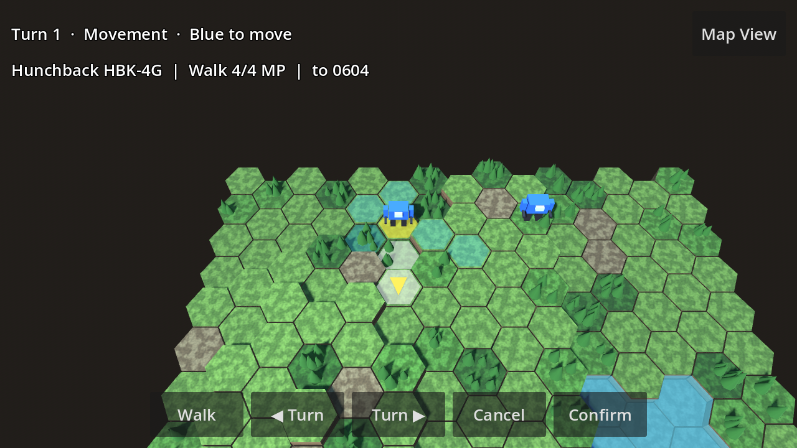

# BtechMobile

A BattleTech (Total Warfare) simulator for Android phones, built with Godot 4.
Full 3D hex maps with elevation, woods and water; touch camera controls; automated rules.



**Status:** first playable slice — load a scenario, select a 'Mech, preview walking/running
paths with facing, and move. Sides alternate by initiative. Combat is next.

## Run it
1. Install [Godot 4.5+](https://godotengine.org/download) (standard build, not .NET).
2. Open `project.godot`, press Play.
   - Mouse: left-drag pan, right-drag orbit/tilt, wheel zoom, click to select/move.
   - Touch: drag pan, pinch zoom, two-finger twist to orbit, two-finger drag to tilt,
     tap to select/move, double-tap to center the camera.
3. Android: *Project → Install Android Build Template*, add an Android export preset, export.

## Tests
```sh
godot --headless --import
godot --headless -s tests/run_tests.gd
```

See `CLAUDE.md` for the file map and `docs/` for architecture, data formats and rules coverage.
